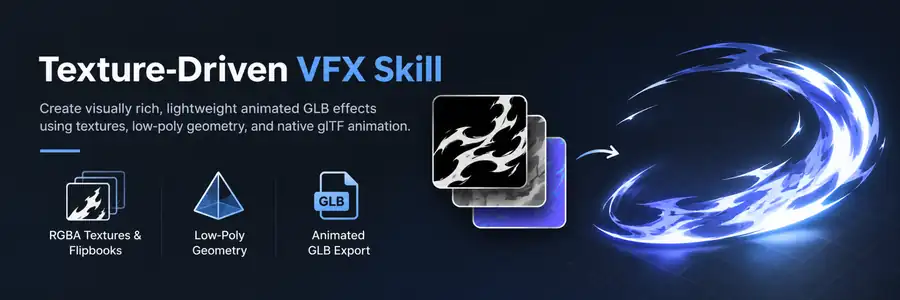
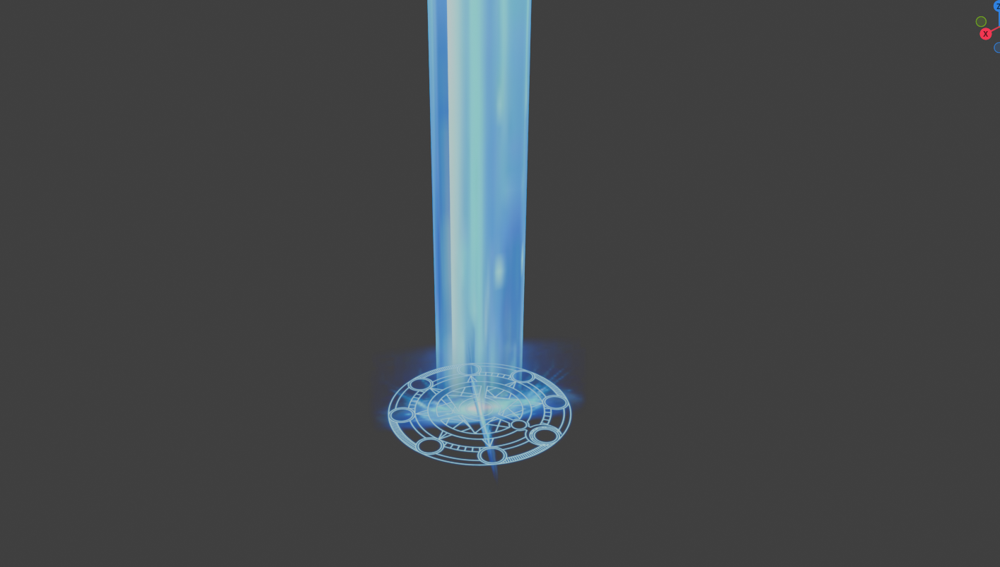

<p align="center">
  
</p>

<p align="center">An open, portable AI skill for creating lightweight animated 3D visual effects.</p>

<p align="center">
  <a href="#installation">Installation</a> ·
  <a href="#usage">Usage</a> ·
  <a href="USAGE.md">Documentation</a> ·
  <a href="SKILL.md">Agent Skill</a> ·
  <a href="LICENSE">License</a>
</p>

---

## What it does

Turn reference videos, images, or effect descriptions into texture-driven animated GLBs for games and real-time 3D applications.

- Detailed RGBA textures, animated flipbooks, and texture atlases.
- Custom low-poly meshes, native transforms, and morph animations.
- Geometry, texture, and draw-call optimization that preserves animation cadence.
- Self-contained GLB exports with no custom shader dependency.
- Automated structural and temporal validation.

## Showcase

<p align="center">
  
</p>

<p align="center"><em>Texture-driven magic beam · Blender viewport preview</em></p>

## Installation

```bash
git clone https://github.com/Vespeuz/texture-driven-vfx-skill.git
cd texture-driven-vfx-skill
python -m pip install -r requirements.txt
```

Copy the complete folder into your AI agent's skills directory, or ask your agent to read [SKILL.md](SKILL.md) directly.

Requires Python 3.10+. FFmpeg and FFprobe are optional for video-based workflows.

## Usage

Give your agent a reference or describe the effect you want to create.

> Use the texture-driven-vfx skill to recreate this magic beam as an animated GLB. Preserve the source animation cadence, use 512 × 512 textures, and target fewer than 10 draw calls.

For a quick procedural example, run:

```bash
python scripts/build_vfx.py --spec examples/rising_shockwave.json --out output/rising_shockwave.glb
```

The skill produces animated GLBs, textures, editable specifications, and validation reports. Draw-call counts are estimates until profiled in the target renderer.

## Documentation

- [Usage guide](USAGE.md) — setup, examples, commands, performance budgets, and compatibility.
- [Agent instructions](SKILL.md) — complete production workflow.
- [VFX techniques](references/V2_TECHNIQUES.md) — flipbooks, custom geometry, layered effects, and optimization.
- [About](about.md) — project overview.

## Contributing

Suggestions, issues, and pull requests are welcome. See the [usage guide](USAGE.md#contributing) for testing and contribution details.

## License

[The Unlicense](LICENSE). Use, modify, share, or sell it freely. No attribution required. Third-party materials retain their respective rights.
